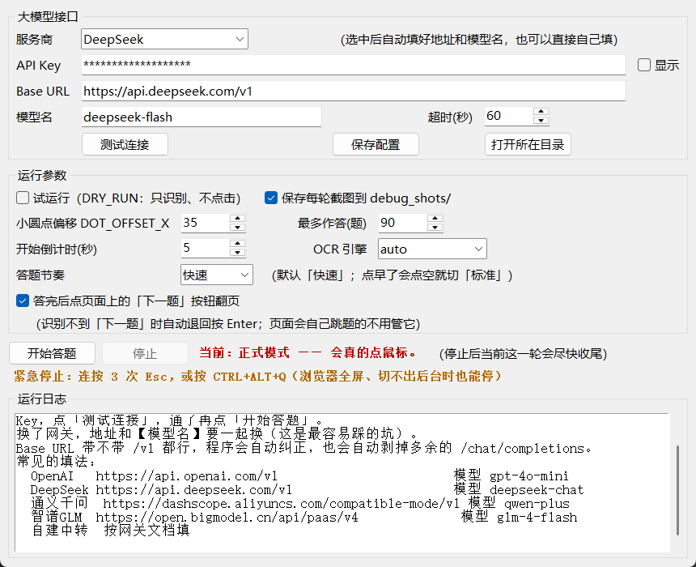

# 在线考试自动答题助手

截图 → OCR 识别题干和选项 → 调大模型给出答案 → 自动点击选项 → 自动翻到下一题。

Windows 桌面工具，纯 Python，可一键打包成 exe。支持任意 OpenAI 兼容接口
（DeepSeek / OpenAI / 通义千问 / 智谱 GLM / 自建中转）。



## 功能

- **OCR**：RapidOCR（ONNX Runtime，模型随包自带，不依赖 Paddle）
- **任意 OpenAI 兼容接口**：界面下拉选服务商，自动填好 Base URL 和模型名
- **地址自动纠正**：Base URL 带不带 `/v1`、多写 `/chat/completions` 都能自动纠正
- **题型识别**：单选 / 多选 / 判断；多选按顺序点多个选项
- **小圆点自适应**：选项自带 `○A、` 这类圆圈时直接用圆圈中心当点击点，
  不再依赖 `DOT_OFFSET_X` 估算
- **自动翻页**：答完点页面上的「下一题」，找不到才退回按 Enter
- **防重复点击**：同一题不会点第二遍（多选不会被点成取消勾选）
- **紧急停止**：连按 3 次 `Esc`，或按 `Ctrl+Alt+Q`。用 `GetAsyncKeyState`
  轮询键盘物理状态，浏览器全屏、切不出后台时同样有效
- **答题节奏**：极速 / 快速 / 标准 三档，默认「快速」
- **调试友好**：每轮截图落到 `debug_shots/`，日志写 `exam_auto_solver.log`

## 环境要求

- Windows 10 / 11
- Python 3.10 及以上

## 安装

```bash
git clone https://github.com/chen374689-coder/tools.git
cd tools
python -m pip install -r requirements.txt
```

## 配置

两种方式，效果一样：

1. **界面里填**（推荐）：服务商 → 自动填地址和模型名 → 填 API Key → 点「测试连接」。
   点「保存配置」会写同目录的 `config.json`。
2. **配置文件**：把 `config.example.json` 复制成 `config.json` 再改。

| 字段 | 说明 |
| --- | --- |
| `api_key` | 网关的 API Key |
| `base_url` | 接口地址，带不带 `/v1` 都行 |
| `model` | 模型名，**必须和网关匹配**（换网关最容易忘这条） |
| `llm_timeout` | 单次接口超时（秒） |
| `dry_run` | `true` = 试运行，只识别不点击 |
| `dot_offset_x` | 选项文字左边缘往左推多少像素是小圆点（页面自带圆圈时不需要） |
| `max_answered` | 最多作答多少题 |
| `start_countdown` | 点开始后留给你切到浏览器的时间（秒） |
| `ocr_backend` | `auto` / `rapidocr` / `paddleocr` |
| `save_debug_screenshot` | 是否保存每轮截图 |
| `click_next_button` | 答完是否点页面上的「下一题」 |
| `speed` | `极速` / `快速` / `标准` |

常见填法：

| 服务商 | Base URL | 模型名 |
| --- | --- | --- |
| OpenAI | `https://api.openai.com/v1` | `gpt-4o-mini` |
| DeepSeek | `https://api.deepseek.com/v1` | `deepseek-chat` |
| 通义千问 | `https://dashscope.aliyuncs.com/compatible-mode/v1` | `qwen-plus` |
| 智谱 GLM | `https://open.bigmodel.cn/api/paas/v4` | `glm-4-flash` |

## 使用

```bash
python exam_bot_gui.py
```

1. 选服务商、填 API Key，点「测试连接」确认能通。
2. 先勾着「试运行（DRY_RUN）」跑一轮，看日志里的题干、选项、圆点坐标对不对。
3. 确认无误后取消勾选「试运行」，点「开始答题」。
4. 窗口会自动最小化，倒计时内把考试页面切到前台全屏。
5. 想停：连按 3 次 `Esc` 或按 `Ctrl+Alt+Q`（跑完窗口会自动弹回最前面）。

> 答题期间鼠标归程序用。这时候 Alt+Tab 切出去，下一次点击又会把页面拉回前台，
> 看起来像「切不出去」。要切出去请先停。

### 命令行自检

```bash
# 不点鼠标、不联网，只验证 OCR + 题目解析链路
python exam_bot_gui.py --selftest

# 不开界面，拿 config.json 直接打一次大模型接口
python exam_bot_gui.py --test-api
```

## 打包成 exe

```powershell
.\build_exe.ps1
```

产物在 `dist\自动答题\`，整个文件夹一起拷走才能运行（`_internal` 里是依赖）。
体积约 260 MB（ONNX Runtime + OCR 模型 + OpenCV）。

## 目录结构

```
.
├─ exam_auto_solve.py     # 引擎：截图 / OCR / 解析 / 点击 / 翻页 / 紧急停止
├─ exam_bot_gui.py        # Tkinter 界面，也是 exe 入口
├─ exam_bot.spec          # PyInstaller 打包配置
├─ build_exe.ps1          # 一键打包脚本
├─ app.ico                # 图标
├─ requirements.txt
├─ config.example.json
├─ 使用说明.txt            # 给最终用户看的详细说明
├─ gui_real.png           # 界面截图
├─ dist/                  # 打包产物（已 git 忽略）
└─ debug_shots/           # 每轮调试截图（已 git 忽略）
```

## 常见问题

**报 `Model Not Exist` / 401**
换了网关只改了地址、忘了改模型名。界面里重新选一次服务商，会把地址和模型名一起填好。

**日志里「没识别到选项」**
看 `debug_shots/` 里那轮截图：答题窗口不能压在考试页上（程序开始时会自动最小化）。
如果选项左边没有圆圈符号，才需要调 `DOT_OFFSET_X`。

**不会点击**
「试运行」还勾着。界面上按钮旁边会写当前模式：橙色是试运行，红色才是真点。

**点了没反应**
页面渲染慢，把「答题节奏」切到「标准」。

**卡在最后一题**
本部分最后一题通常只剩「保存」没有「下一题」。程序不会自己交卷，
日志里会提示，手动交卷 / 翻到下一部分即可。

## 免责声明

本项目用于学习 OCR、桌面自动化和大模型接口调用。请在你**有权操作**的环境中使用，
并遵守所在学校 / 单位关于在线考试的规定。作者不对使用本工具造成的任何后果负责。

## License

MIT
